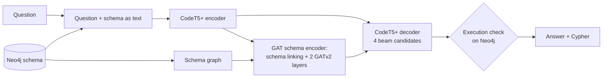

# Graph Attention Transformer Framework for Natural Language to Cypher Query Generation in Financial Transaction Graphs

Ask a graph database a question in plain English and get the answer. The system translates the question into
**Cypher** (the query language of Neo4j), runs it, and returns the result, with a focus on **financial transaction
graphs** (accounts, banks, owners and money transfers).

```
Question:  Who is the entity with the largest number of accounts?
Cypher:    MATCH (e:Entity)-[:OWNS]->(a:Account)
           RETURN e.name, count(a) AS n ORDER BY n DESC LIMIT 1
Answer:    Corporation #34854 (7,820 accounts)
```

This is an NLP **semantic parsing** project: the hard part is *schema linking*, grounding the words of a question
in the labels, relationships and properties of a database the model may never have seen.

## Results

On **55 hand-written financial questions** over a Neo4j graph of **5.08 million transfers** built from IBM AMLworld:

| Setup | Before fine-tuning | After financial fine-tuning |
|---|---|---|
| Baseline (CodeT5+) | 25.5% | 78.2% |
| Baseline + execution check | 27.3% | 80.0% |
| GAT | 30.9% | 70.9% |
| **GAT + execution check (our model)** | **34.5%** | **72.7%** |

- On a financial database the model has never seen, our model is the strongest setup.
- Financial fine-tuning more than doubles accuracy; questions about transfer details (amount, currency, laundering
  flag) go from 0 to 16 of 25.
- After fine-tuning the baseline is slightly ahead, but not significantly (McNemar test, p = 0.34).

Metric: **execution accuracy**, meaning the generated query returns the same result as the reference query.
Full details are in [EXPERIMENTS.md](EXPERIMENTS.md).

## How it works



1. **Text encoder:** CodeT5+ 220M reads the question and the database schema written as text.
2. **GAT schema encoder (our contribution):** every label, relationship type and property becomes a node; nodes
   attend to the question (schema linking), and two relation-aware GATv2 layers pass this along the schema. The
   node vectors join the encoder output, so the decoder sees both the words and the schema graph.
3. **Execution check:** beam search proposes 4 queries; each runs on Neo4j (read-only) and the first that returns
   rows is kept. The reference answer is never used.
4. **Financial fine-tuning:** the model learns Cypher from the Mind the Query benchmark, then is fine-tuned on 981
   synthetic financial questions (test values held out) mixed with 3,000 replayed benchmark pairs.

| Part | Parameters |
|---|---|
| CodeT5+ backbone (12 + 12 layers, hidden size 768) | 222,882,048 |
| GAT schema encoder | 6,511,104 |
| **Total** | **229,393,152** |

## Datasets

| Dataset | Size | Used for |
|---|---|---|
| [Mind the Query](https://github.com/endeavorXx/Mind-the-Query) | 27,529 question-Cypher pairs, 11 Neo4j databases | Learning Cypher (training, validation) |
| [IBM AMLworld HI-Small](https://www.kaggle.com/datasets/ealtman2019/ibm-transactions-for-anti-money-laundering-aml) (CDLA-Sharing 1.0) | 5,078,345 transfers, 518,581 accounts, 166,207 entities, 30,470 banks | Financial transaction graph |
| Financial test set (ours, `src/aml_questions.py`) | 55 questions with reference Cypher | Financial evaluation |
| Synthetic financial training set (ours, `src/make_aml_train.py`) | 981 question-Cypher pairs | Financial fine-tuning |

Datasets and trained models are **not** in this repository (size and licences); see the setup steps below.

Financial graph schema:

```
(:Entity {name, entity_type})-[:OWNS]->(:Account {account_number})-[:HELD_AT]->(:Bank {name, country, is_crypto})
(:Account)-[:TRANSFERRED_TO {amount_paid, payment_currency, payment_format, is_laundering,
                             laundering_pattern, timestamp, ...}]->(:Account)
```

## Repository structure

```
streamlit_app.py           web demo (entry point)
app_pages/                 demo pages (ask a question, results)
src/
  load_mtq_graphs.py       load the Mind the Query databases into Neo4j
  build_aml_graph.py       build the financial graph from AMLworld
  prepare_mtq.py           clean the benchmark and split it by database
  serialize.py             write a schema as model input text
  gat_model.py             schema graph + GAT schema encoder
  train_baseline.py        training: baseline, GAT (--gat), fine-tuning (--init_from/--extra)
  predict.py               beam search, execution check (--exec_guided), scoring
  evaluate.py              execution accuracy, exact match, validity
  aml_questions.py         55 financial test questions
  make_aml_train.py        synthetic financial training data
  check_aml.py             financial evaluation
  inference.py, app_utils.py   single-question inference for the demo
SETUP.md  DATA.md  EXPERIMENTS.md   detailed setup, data notes and results
```

## Setup

Requirements: Windows or Linux, an NVIDIA GPU (developed on an RTX 5050, 8 GB), Python 3.11, Neo4j Desktop.

```bash
uv venv --python 3.11 .venv
uv pip install --python .venv/Scripts/python.exe torch --index-url https://download.pytorch.org/whl/cu128
uv pip install --python .venv/Scripts/python.exe -r requirements.txt
```

1. Install **Neo4j Desktop**, create and start a local instance, and set its memory (page cache 2 GB recommended
   for the 5-million-transfer graph).
2. Copy `.env.example` to `.env` and fill in the Neo4j password and paths. Never commit `.env`.
3. Download the datasets and load the graphs as described in [SETUP.md](SETUP.md).

> **Windows Smart App Control:** if Windows blocks Python or `streamlit.exe`, base the environment on the signed
> python.org Python 3.11 (`python -m venv --upgrade .venv`) and always start tools as
> `.venv\Scripts\python.exe -m <tool>`.

## Usage

All commands run from the project folder with Neo4j running (PowerShell shown).

**Prepare data**

```bash
.venv\Scripts\python.exe src\load_mtq_graphs.py
.venv\Scripts\python.exe src\build_aml_graph.py
.venv\Scripts\python.exe src\prepare_mtq.py
```

**Train**

```bash
.venv\Scripts\python.exe src\train_baseline.py --run baseline_t5
.venv\Scripts\python.exe src\train_baseline.py --gat --run gat_t5 --epochs 2
```

**Fine-tune on financial data**

```bash
.venv\Scripts\python.exe src\make_aml_train.py
.venv\Scripts\python.exe src\train_baseline.py --gat --run gat_aml --init_from gat_t5 --extra data/processed/aml_train.jsonl --replay 3000 --epochs 2 --lr 5e-5
```

**Evaluate on the financial test set**

```bash
.venv\Scripts\python.exe src\check_aml.py --baseline baseline_aml --gat gat_aml --out aml_check_adapted
```

**Run the demo**

```bash
.venv\Scripts\python.exe -m streamlit run streamlit_app.py
```

Open http://localhost:8501, choose a database, and type a question or click a sample. The app shows the answer, with
the generated Cypher in a dropdown. It uses the financially fine-tuned model for the financial graph.

## Limitations and future work

- The model must guess how values are spelled in the database ("Partnership" vs "partnerships").
- Long questions with several conditions remain hard (complex retrieval).
- After fine-tuning, the graph encoder no longer beats the baseline.
- Future work: value linking, grammar-constrained decoding, schema augmentation, real banking data.

## Team

Team 15, School of Computer Science and Engineering, RV University, Bengaluru

| Name | USN |
|---|---|
| R Muni Disnitha | 1RUA24CSE0345 |
| Saanvi Mahipati | 1RUA24CSE0389 |
| Sanjana B | 1RUA24CSE0408 |
| Sanjana Gothe | 1RUA24CSE0410 |

Guide: Prof. Priyanka S Shivaramaiah

## Acknowledgements

Mind the Query (Chauhan et al., EMNLP 2025), IBM AMLworld (Altman et al., NeurIPS 2023), CodeT5+ (Salesforce),
PyTorch Geometric, Hugging Face Transformers and Neo4j.
